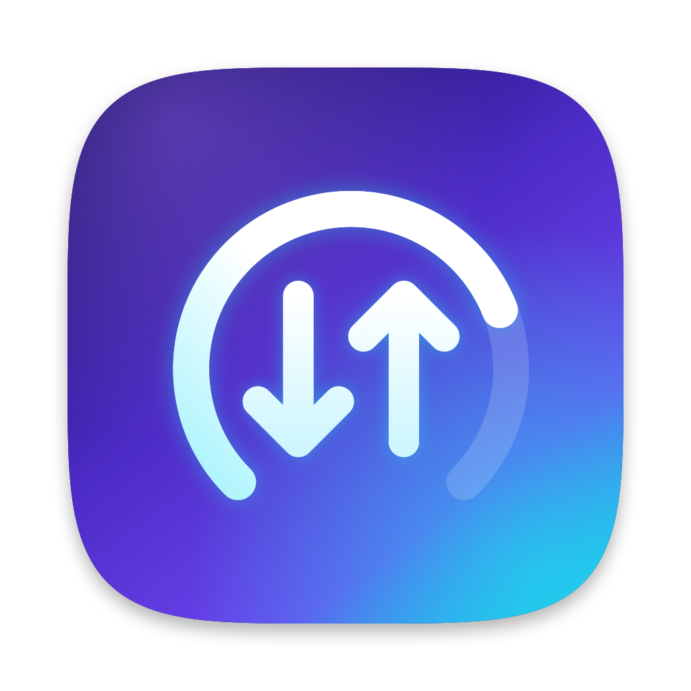

# Adalmon

macOS 26+ için menü çubuğu sistem monitörü: CPU, GPU, RAM, disk, sıcaklıklar ve **uygulama / site bazlı ağ kullanımı**.

## Öne çıkanlar
- **Uygulama ve domain bazlı ağ ölçümü:** `NEFilterDataProvider` system extension ile her akış sayılır (ör. Chrome › YouTube). Yerel DPI-bypass proxy'leri (SpoofDPI, ByeDPI) varken de trafik doğru uygulamaya yazılır, çift sayım yapılmaz.
- **Mobil veri koruması:** iPhone hotspot (Wi-Fi/USB) otomatik algılanır. Günlük limit, "son 1 dakikada X MB" uyarısı, mobilde tek tıkla engelleme.
- **Hız sınırı (deneysel):** `NETransparentProxyProvider` ile uygulama bazlı ↓/↑ sınırı.
- **Özelleştirilebilir menü çubuğu:** metrik kartları, tek satır / etiket üstte / simge düzenleri, gelişmiş bileşen düzenleyici.
- **Düşük enerji:** boşta ~%0,5–1 CPU.

## Derleme
Gereksinimler: Xcode 27+, [XcodeGen](https://github.com/yonaskolb/XcodeGen), Network Extension yetkisi olan bir Apple geliştirici hesabı.

Önce kendi kimliğini yerel (gitignored) dosyaya yaz; depoda takım kimliği ya da paket öneki yoktur:

```bash
cat > Config/Identity.local.xcconfig <<'CONF'
ADALMON_TEAM_ID = ABCDE12345          # developer.apple.com › Membership › Team ID
ADALMON_BUNDLE_PREFIX = com.sirketin  # ters alan adı; uygulama "com.sirketin.adalmon" olur
CONF
```

```bash
brew install libimobiledevice && tools/vendor-libimobiledevice.sh   # iPhone/iPad pil detayı için gömülü dylib'ler
xcodegen generate
xcodebuild -project Adalmon.xcodeproj -scheme Adalmon -configuration Release \
  -derivedDataPath build -allowProvisioningUpdates build
```

Takım kimliği ve paket öneki `Config/Identity.xcconfig` üzerinden okunur; `xcodegen generate` bunlardan Swift sabitlerini (`Sources/Identity/Identity.generated.swift`, gitignored) üretir. Hepsini kendi hesabına göre `Config/Identity.local.xcconfig`'te ver. System extension'ın yüklenebilmesi için uygulama `/Applications` altında çalışmalıdır.

## Notlar
- Sıcaklık (IOHID, SMC) ve GPU yükü (IOReport) özel API'ler kullanır; App Store'a uygun değildir.
- `docs/` klasöründe araştırma notları ve test planları var.

## Üçüncü taraf bileşenler

iPhone/iPad pil ayrıntıları (Pil › iPhone & iPad) için şu kitaplıklar `Adalmon.app/Contents/Frameworks` içinde, değiştirilmeden ve çalışma zamanında `dlopen` ile yüklenir:

| Kitaplık | Lisans | Kaynak |
|---|---|---|
| libimobiledevice 1.0.6 | LGPL-2.1-or-later | https://github.com/libimobiledevice/libimobiledevice |
| libimobiledevice-glue 1.0.0 | LGPL-2.1-or-later | https://github.com/libimobiledevice/libimobiledevice-glue |
| libplist 2.0.12 | LGPL-2.1-or-later | https://github.com/libimobiledevice/libplist |
| libusbmuxd 2.0.7 | LGPL-2.1-or-later | https://github.com/libimobiledevice/libusbmuxd |
| OpenSSL (libssl, libcrypto) 4.x | Apache-2.0 | https://github.com/openssl/openssl |

LGPL gereği bu kitaplıkları değiştirilmiş sürümleriyle değiştirebilirsin (uygulamayı yeniden imzala). Lisans metinleri `Vendor/libimobiledevice/licenses/` altındadır; uygulamada Ayarlar › Genel › Lisanslar bölümünde de listelenir.
Kitaplıkları yeniden üretmek için: `brew install libimobiledevice && tools/vendor-libimobiledevice.sh` (kurulum adlarını `@rpath`'e çevirir; imzayı Xcode derleme sırasında takım kimliğiyle atar).
